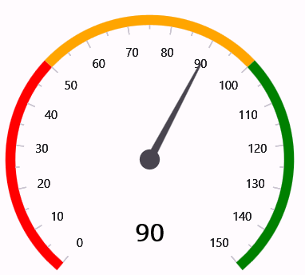

# Getting Started with .NET MAUI Radial Gauge

## Creating an application using the .NET MAUI Radial Gauge

The [.NET MAUI Radial Gauge](https://www.syncfusion.com/maui-controls/maui-radial-gauge?utm_source=github&utm_medium=listing&utm_campaign=maui-radial-gauge-github-samples) is a multi-purpose data visualization control that displays numerical values on a circular scale with customizable axes, ranges, pointers, and annotations. This guide will help you integrate the Radial Gauge control into your .NET MAUI application.

### Step 1: Create a new .NET MAUI application in Visual Studio

1. Go to **File > New > Project** and choose the **.NET MAUI App** template.
2. Name the project and choose a location. Click **Next**.
3. Select the .NET framework version and click **Create**.

### Step 2: Install the Syncfusion .NET MAUI Gauges NuGet package

1. In **Solution Explorer**, right-click the project and choose **Manage NuGet Packages**.
2. Search for Syncfusion.Maui.Gauges and install the latest version.
3. Ensure the necessary dependencies are installed correctly, and the project is restored.

### Step 3: Register the Syncfusion handler

Syncfusion.Maui.Core NuGet is a dependent package for all Syncfusion controls of .NET MAUI. In the MauiProgram.cs file, register the handler for Syncfusion core.

**[C#]**
```csharp
using Microsoft.Maui;
using Microsoft.Maui.Hosting;
using Syncfusion.Maui.Core.Hosting;

namespace RadialGaugeGettingStarted
{
    public static class MauiProgram
    {
        public static MauiApp CreateMauiApp()
        {
            var builder = MauiApp.CreateBuilder();
            builder
                .UseMauiApp<App>()
                .ConfigureSyncfusionCore()
                .ConfigureFonts(fonts =>
                {
                    fonts.AddFont("OpenSans-Regular.ttf", "OpenSansRegular");
                });

            return builder.Build();
        }
    }
}
```

### Step 4: Add the Radial Gauge namespace

Import the Gauge namespace to your XAML or C# code.

**[XAML]**
```xaml
xmlns:gauge="clr-namespace:Syncfusion.Maui.Gauges;assembly=Syncfusion.Maui.Gauges"
```

**[C#]**
```csharp
using Syncfusion.Maui.Gauges;
```

### Step 5: Initialize the Radial Gauge

Initialize the [SfRadialGauge]() and configure axes, ranges, and pointers to display your data.

**[XAML]**
```xaml
<ContentPage   
    xmlns="http://schemas.microsoft.com/dotnet/2021/maui"
    xmlns:x="http://schemas.microsoft.com/winfx/2009/xaml"
    xmlns:gauge="clr-namespace:Syncfusion.Maui.Gauges;assembly=Syncfusion.Maui.Gauges"
    x:Class="RadialGaugeGettingStarted.MainPage">

    <Grid>
        <gauge:SfRadialGauge>
            <gauge:SfRadialGauge.Axes>
                <gauge:RadialAxis Minimum="0" Maximum="100">
                    <gauge:RadialAxis.Pointers>
                        <gauge:NeedlePointer Value="75" />
                    </gauge:RadialAxis.Pointers>
                </gauge:RadialAxis>
            </gauge:SfRadialGauge.Axes>
        </gauge:SfRadialGauge>
    </Grid>
</ContentPage>
```

**[C#]**
```csharp
using Syncfusion.Maui.Gauges;
. . .

public partial class MainPage : ContentPage
{
    public MainPage()
    {
        this.InitializeComponent();
        
        SfRadialGauge radialGauge = new SfRadialGauge();
        
        RadialAxis axis = new RadialAxis();
        axis.Minimum = 0;
        axis.Maximum = 100;
        
        NeedlePointer pointer = new NeedlePointer();
        pointer.Value = 75;
        
        axis.Pointers.Add(pointer);
        radialGauge.Axes.Add(axis);

        this.Content = radialGauge;
    }
}
```

